[

  
  
  
  


 

<table>
<tr>
<td width="62%" valign="top">

**The short version.** I'm a Computer Science undergraduate at **JNTU Hyderabad** (B.Tech, 2024 to 2028, CGPA 8.03). I build machine-learning systems for problems where **the obvious signal lies**: an agent run returns `200 OK` while it loops forever, a thermal frame looks empty while a 20-pixel person crosses it, a discount looks profitable until you count the customers who would have bought anyway.

My pattern is to build the instrument that shows what is really happening, measure it on held-out data, and then build the system that acts on it.

**Mission:** HawkEye AI, thermal surveillance aimed at India's border and perimeter security.

</td>
<td width="38%" valign="top">

FOCUS 
LLM and agent reliability 
Computer vision at the edge 
Local-first AI assistants 
Real-time systems 
Applied ML for decisions

OPEN TO 
ML and AI-systems internships, research collaborations, hackathon teams

</td>
</tr>
</table>

 


<h3>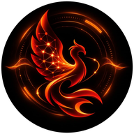 &nbsp;P.H.O.E.N.I.X. &nbsp;A private, voice-first AI operator that runs entirely on my laptop</h3>

<b>Personal Hyper-intelligent Operations &amp; Engineering Network for Intelligent eXecution.</b>

Say *"Hey Phoenix"*, and a full-screen particle HUD wakes up, transcribes you locally, reasons with an open model on a 6 GB laptop GPU, acts through **72 tools**, and speaks back. It is about **7,900 lines of Python** plus a WebGL HUD, designed and built by me. The hard part was never getting an assistant to *do* things. It was making it **safe to let it**.

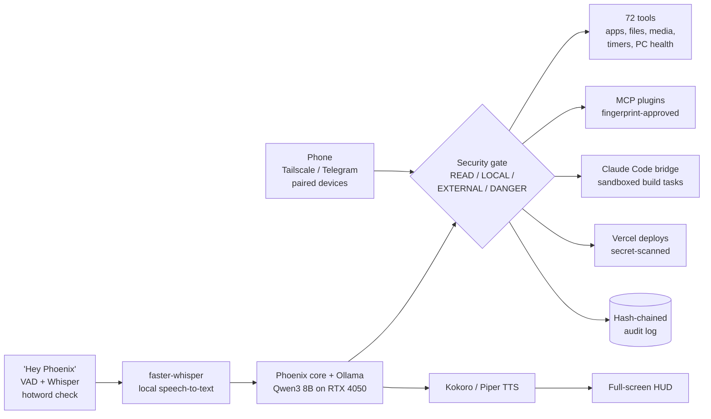

<table>
<tr>
<th width="50%" align="left">What it does</th>
<th width="50%" align="left">How it stays safe</th>
</tr>
<tr>
<td valign="top">

- **Custom wake word:** "Hey Phoenix" has no off-the-shelf model, so short speech bursts are cut out by voice-activity detection and confirmed by an on-device Whisper pass biased toward the word, with a pretrained wake-word model as a backup
- **Runs my PC by voice:** apps, files, windows, media, volume, brightness, timers, reminders, notes and screenshots
- **Career agent:** pulls internships from official Greenhouse, Lever and Ashby APIs, ranks them against my résumé and tracks applications. It never applies on my behalf
- **Learning coach:** day-by-day study plans, spoken lessons, voice quizzes with spaced repetition and a radar over Hacker News, arXiv and GitHub
- **Engineering co-pilot:** detects a project's type, checkpoints it, runs its tests, previews it and deploys it, and hands build tasks to Claude Code
- **Watches my other systems:** live CPU/GPU health with safe fixes, and a supervisor that reads my Agent Observability dashboard and reports spikes
- **Quantum lab:** a 12-qubit statevector simulator with Bloch vectors drawn in the HUD

</td>
<td valign="top">

- **Four risk tiers** on every tool. Deleting, deploying or publishing needs a **physical click**, so a voice in a video can't approve it
- **Prompt-injection guard:** once web pages, clipboard, screen or plugin output are in play, the gate tightens automatically
- **Tamper-evident audit log:** each entry carries the SHA-256 of the previous one, so any edit breaks the chain
- **Secrets never touch files or the model:** keys live in Windows Credential Manager and are injected only into the process that needs them
- **Plugins are approved by fingerprint:** if a plugin's config or code changes, it goes back to "needs approval"
- **Phone access is private:** Tailscale only, with 6-digit pairing, 256-bit device tokens and lockouts after wrong codes
- **Audio never leaves the laptop**

</td>
</tr>
</table>

<b>STACK</b> &nbsp; <code>Ollama</code> <code>Qwen3 8B</code> <code>faster-whisper</code> <code>openWakeWord + VAD</code> <code>Kokoro / Piper TTS</code> <code>MCP (JSON-RPC)</code> <code>Claude Code</code> <code>Tailscale</code> <code>SQLite</code> <code>WebGL</code> <code>Win32 APIs</code>

 


<table>
<tr>
<td width="50%" valign="top">

<a href="https://github.com/codewithtej1220/PromoForge---Prometheus"></a>

**PromoForge (Prometheus)** recommends retail promotions that are profitable and won't empty the shelves, and explains every one. **Winner, 1st of 45 teams at TCS Tech Day, JNTUH**, with a Certificate of Appreciation from TCS.

**899 of 1,944** promos blocked for margin or stock &nbsp;·&nbsp; **₹11.6 L** extra profit from the 15 selected

<b><a href="https://github.com/codewithtej1220/PromoForge---Prometheus">View code &rarr;</a></b>

<code>Causal ML</code> <code>Uplift modelling</code> <code>Demand forecasting</code> <code>scikit-learn</code> <code>Pandas</code> <code>FastAPI</code> <code>Next.js</code>

</td>
<td width="50%" valign="top">

<a href="https://github.com/codewithtej1220/agent-observability-system"></a>

**Agent Observability** catches LLM agents failing silently (infinite loops, tool thrashing, hallucinated tool calls, token waste) while the run is still going, then picks the fix. **Solo build.**

**97.3%** precision &nbsp;·&nbsp; **98.1%** recall &nbsp;·&nbsp; **0.9%** false positives &nbsp;·&nbsp; **+41%** reward vs a fixed playbook

<b><a href="https://github.com/codewithtej1220/agent-observability-system">View code &rarr;</a></b>

<code>Anomaly detection</code> <code>Contextual bandits</code> <code>scikit-learn</code> <code>HDBSCAN</code> <code>FastAPI</code> <code>PostgreSQL</code> <code>React</code> <code>Python SDK</code> <code>Docker</code>

</td>
</tr>
<tr>
<td width="50%" valign="top">

<a href="https://github.com/codewithtej1220/hawkeye-ai"></a>

**HawkEye AI** is thermal drone surveillance aimed at India's border and perimeter security: it finds people and weapons at night from 5 to 30 m up and streams scored threats to a live dashboard. **Team of 4; I was the ML engineer** (dataset creation, YOLOv11m training, the dual-model detector and system integration).

**265 ms** frame to dashboard &nbsp;·&nbsp; **+20%** recall with SAHI &nbsp;·&nbsp; **98.3%** human precision

<b><a href="https://github.com/codewithtej1220/hawkeye-ai">View code &rarr;</a></b>

<code>PyTorch</code> <code>YOLOv11m</code> <code>SAHI</code> <code>OpenCV</code> <code>CUDA</code> <code>AirSim</code> <code>Unreal Engine</code> <code>FastAPI</code> <code>WebSockets</code> <code>React</code>

</td>
<td width="50%" valign="top">

<a href="https://github.com/codewithtej1220/CredX"></a>

**CredX** turns a pile of financial and legal PDFs into an explainable, committee-ready credit decision for Indian corporate lending: extraction, research, fraud screening, scoring, loan sizing and pricing, a Credit Appraisal Memo and an analyst copilot. **Team project.**

**0.88** AUC (Gini 0.77) &nbsp;·&nbsp; exact TreeSHAP &nbsp;·&nbsp; credit memo export to PDF, DOCX and HTML

<b><a href="https://github.com/codewithtej1220/CredX">View code &rarr;</a></b>

<code>FinTech</code> <code>Credit risk</code> <code>Document AI</code> <code>Fraud analytics</code> <code>XGBoost</code> <code>TreeSHAP</code> <code>LLM copilot</code> <code>FastAPI</code> <code>Next.js</code>

</td>
</tr>
<tr>
<td width="50%" valign="top">

<a href="https://quantaverse-nu.vercel.app/"></a>

**QuantaVerse** teaches quantum computing from the qubit to Shor's algorithm, with a drag-and-drop circuit sandbox, graded labs, an AI tutor and progress tracking. **Team project, Smart India Hackathon 2026 national round.**

**8** modules &nbsp;·&nbsp; runs fully in the browser &nbsp;·&nbsp; graded on state fidelity

<b><a href="https://quantaverse-nu.vercel.app/">Live prototype &rarr;</a> &nbsp;·&nbsp; <a href="https://www.youtube.com/watch?v=-_SifbaUqAA">Demo video &rarr;</a> &nbsp;·&nbsp; <a href="https://github.com/codewithtej1220/quantaversegit">View code &rarr;</a></b>

<code>Quantum computing</code> <code>Qiskit</code> <code>Cirq</code> <code>PennyLane</code> <code>Next.js</code> <code>TypeScript</code> <code>FastAPI</code>

</td>
<td width="50%" valign="top">

<a href="https://github.com/codewithtej1220/DialogAI"></a>

**DialogAI** coaches you like a strict audience: it analyses what you say, how you say it and how you look while saying it, scores the session, and asks the follow-up questions a real examiner would.

**< 15 s** to a full report &nbsp;·&nbsp; **94%** accuracy on landmarks and filler words &nbsp;·&nbsp; **40%** faster video pipeline

<b><a href="https://github.com/codewithtej1220/DialogAI">View code &rarr;</a></b>

<code>Whisper</code> <code>MediaPipe</code> <code>NLP</code> <code>LLM coaching</code> <code>FastAPI</code> <code>WebSockets</code> <code>PostgreSQL</code> <code>Celery</code> <code>Next.js</code>

</td>
</tr>
<tr>
<td width="50%" valign="top">

<a href="https://github.com/codewithtej1220/Online-Examination-System"></a>

**Exam-Ethos (OES Pro)** is a complete AI-proctored examination platform for Admin, Faculty and Student roles: question generation, video and audio proctoring, grading and reports. **Team project.**

**70%** less manual grading &nbsp;·&nbsp; **92%** correlation with human graders &nbsp;·&nbsp; **< 200 ms** responses

<b><a href="https://github.com/codewithtej1220/Online-Examination-System">View code &rarr;</a></b>

<code>Computer vision</code> <code>Audio signal processing</code> <code>Biometrics</code> <code>RAG</code> <code>Gemini</code> <code>React</code> <code>Node.js</code> <code>MySQL</code> <code>TensorFlow</code> <code>RBAC</code>

</td>
<td width="50%" valign="top">

<a href="https://github.com/codewithtej1220/GraphMind"></a>

**GraphMind** is a step-through debugger and code graph for Python, JavaScript, TypeScript, C, C++, Java, Go and R, with a measured Big-O view. **Lead developer, team of 3.**

**8** languages traced &nbsp;·&nbsp; complexity fitted from O(1) to O(2ᴺ)

<b><a href="https://github.com/codewithtej1220/GraphMind">View code &rarr;</a></b>

<code>Tree-sitter</code> <code>Compilers and instrumentation</code> <code>Monaco</code> <code>React Flow</code> <code>Chart.js</code> <code>Next.js</code> <code>Docker</code>

</td>
</tr>
</table>

<b>More builds</b>

 

| Project | What it is | Key techniques |
|:--|:--|:--|
| **[ProjectPulse](https://github.com/codewithtej1220/Project-Pulse)** | Reviewed, persistent memory for AI coding agents (team, HackwithHyderabad 3.0) | Human review gate for memories, native MCP server, Hindsight memory layer, Memory Check against agent output |
| **Amazon ML Challenge 2026** | Business entity resolution | Blocking plus a LightGBM matcher over 60K+ candidate pairs: F0.5 = 0.992, 99.5% precision, 98.0% recall |
| **MoodSync** | Mood-aware, room-synced music | NLP emotion classification; shared WebSocket rooms whose queue follows the group's mood |
| **Human Healthcare Hub** | Conversational mental-health space | Chat flow driven by sentiment and context |

 

| Result | Value | Project | Measured on |
|:--|:--|:--|:--|
| Agent-failure precision / recall / false positives | **97.3% / 98.1% / 0.9%** | Agent Observability | 1,500 held-out simulated runs |
| Failing runs flagged within 2 steps of onset | **74%** | Agent Observability | Real agent traces |
| Failing-run tokens avoidable | **71%** | Agent Observability | Real agent traces |
| Intervention reward vs a fixed playbook | **+41%** | Agent Observability | LinUCB policy evaluation |
| Entity-resolution F0.5 (precision / recall) | **0.992** (99.5% / 98.0%) | Amazon ML Challenge 2026 | 60K+ candidate pairs |
| Credit-default AUC (Gini) | **0.88** (0.77) | CredX | Synthetic validation portfolio |
| Extra profit from 15 selected promotions | **₹11.6 L** | PromoForge | Diwali plan, 8,000-customer retail twin |
| Frame-to-dashboard latency (inference) | **265 ms** (152 ms) | HawkEye AI | Live AirSim pipeline |
| Uptime | **99.998%** | HawkEye AI | 48-hour stress test |
| Recall gain on low-resolution thermal targets | **+20%** | HawkEye AI | SAHI vs full-frame YOLOv11m |
| Human-detection precision | **98.3%** | HawkEye AI | 80 test images |
| Landmark and filler-word accuracy | **94%** | DialogAI | Session analysis |
| Time to a full coaching report | **< 15 s** | DialogAI | End-to-end session |
| Manual grading removed (agreement) | **70%** (0.92 correlation) | Exam-Ethos | LLM vs human graders |

 


  

| | Daily drivers | Also shipped with |
|:--|:--|:--|
| **Languages** | Python, TypeScript, SQL | JavaScript, Java, C, C++, R, Dart, HTML5, CSS3 |
| **Machine learning** | PyTorch, scikit-learn, XGBoost | LightGBM, TensorFlow, SHAP, NumPy, Pandas, HDBSCAN, IsolationForest, k-NN, uplift modelling, demand forecasting, contextual bandits |
| **Vision and audio** | YOLOv11, SAHI, OpenCV, MediaPipe | DeepFace / FaceNet, head-pose estimation, thermal imagery, Whisper, faster-whisper, Librosa, openWakeWord, Kokoro and Piper TTS |
| **LLMs and agents** | OpenAI, Claude and Gemini APIs, MCP, Ollama | RAG, LLM-as-judge, prompt engineering, Claude Code automation, Hindsight, Hugging Face |
| **Backend and real-time** | FastAPI, WebSockets, PostgreSQL | Node.js, Express, Socket.IO, REST, JWT, RBAC, Celery, Redis, SQLAlchemy, Alembic, MySQL, SQLite |
| **Frontend** | React, Next.js, Tailwind CSS | three.js, WebGL, Monaco, React Flow, Chart.js, shadcn/ui, Vite, Flutter |
| **Infrastructure** | Docker, GitHub Actions, Vercel | Docker Compose, Jenkins, Render, Tailscale, Google Cloud (Vertex AI, BigQuery), NVIDIA CUDA |
| **Simulation and science** | Microsoft AirSim, Unreal Engine | Qiskit, Cirq, PennyLane, Tree-sitter parsing and instrumentation |
| **Tools** | Git, GitHub, VS Code | Google Colab, Jupyter, Anaconda, PowerShell |

 


| Principle | In practice |
|:--|:--|
| **Latency is a feature** | Async pipelines and WebSocket streaming end to end; HawkEye stays under 300 ms from frame to dashboard. |
| **Measure before you claim** | Held-out evaluation sets, precision/recall/FPR tables and predicted-vs-actual calibration. Every number above comes with its method. |
| **Fallbacks everywhere** | In-browser simulation when the API is down, a Qiskit read-out when the LLM key is missing, model fallback when a contract fails. |
| **Safe by default** | Risk tiers, physical approval for destructive actions, tamper-evident logs and secrets kept out of files and prompts. |
| **One-command onboarding** | Docker Compose, launch scripts and defaults that work out of the box. A reviewer shouldn't need a call with me to run my code. |
| **Structure and safety** | RBAC, schema-validated contracts, PII checks and indexed relational schemas. |

 

| Result | Event | With |
|:--|:--|:--|
| **Winner, 1st of 45 teams** | TCS Tech Day Hackathon, JNTUH | PromoForge (Prometheus), plus a Certificate of Appreciation from TCS |
| **National round** | Smart India Hackathon 2026 | QuantaVerse |
| **F0.5 = 0.992** | Amazon ML Challenge 2026 | Business entity resolution |
| **Team build** | HackwithHyderabad 3.0 | ProjectPulse |
| **Certified** | Google Cloud, Machine Learning Specialization | Vertex AI pipelines, BigQuery |
| **Certified** | Generative AI Learning Certification | Prompt engineering, LLM tuning, agentic loops |
| **Ongoing** | Competitive programming, LeetCode | Data structures and algorithmic optimization |

 

- **P.H.O.E.N.I.X.:** tuning the new wake word, hardening the security gate and moving more skills into MCP plugins
- **HawkEye AI:** upgrading detection for **distant people**, targets only a few pixels tall in high-altitude thermal frames
- **Agent Observability:** moving from simulated runs to real production agent traces
- **QuantaVerse:** more graded labs and noise-model simulation
- **Reading:** open-set anomaly detection, contextual bandits and small-object detection in aerial imagery

 

](https://github.com/codewithtej1220/codewithtej1220.git)
